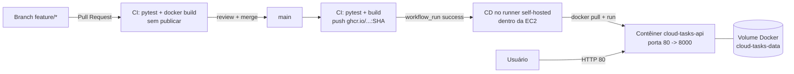

# Relatório — Esteira CI/CD da Cloud Tasks API na AWS

**Disciplina:** Computação em Nuvem — Trabalho final
**Integrante:** Henrique Nassif Braga (trabalho individual)
**Repositório:** https://github.com/HNassifBraga/cloud-pipeline-starter

## 1. Distribuição das tarefas

| Tarefa | Responsável |
|---|---|
| Código (`DELETE /tasks/<id>`, filtro `?done=`, `/version`) e testes | Henrique Nassif Braga |
| CI/CD (GitHub Actions, GHCR, runner self-hosted) | Henrique Nassif Braga |
| Infraestrutura AWS (EC2, Security Group, IAM, Session Manager) | Henrique Nassif Braga |
| Documentação, evidências e encerramento dos recursos | Henrique Nassif Braga |

## 2. Arquitetura



**Fluxo:**
1. Desenvolvimento em branch `feature/...` e abertura de Pull Request.
2. A CI (`ci.yml`) roda `pytest` e `docker build` no PR, sem login nem push no registry.
3. Depois do review e do merge, a CI roda de novo na `main` e publica `ghcr.io/hnassifbraga/cloud-pipeline-starter:<SHA do commit>`, com `APP_VERSION=<SHA>` embutido na imagem.
4. O CD (`cd.yml`) dispara por `workflow_run` somente se a CI terminou com sucesso em um `push` na `main`. Ele roda no **runner self-hosted da EC2**, faz login no GHCR com o `GITHUB_TOKEN` efêmero do job, executa `scripts/deploy.sh` e confere `/health` e `/version` (o SHA precisa bater com o commit).

### Por que runner self-hosted (decisão de segurança)
O enunciado proíbe SSH aberto para `0.0.0.0/0`, e os runners hospedados do GitHub não têm IP fixo. Com o runner instalado na própria EC2:
- a conexão é **de saída** (EC2 → GitHub por HTTPS 443), então não é preciso liberar SSH para o GitHub;
- **nenhuma chave SSH privada** fica em secrets do GitHub;
- o acesso administrativo à instância é feito pelo **AWS Systems Manager Session Manager** (autenticação IAM, sem porta aberta).

Mitigações para repositório público com runner self-hosted:
- o job de CD só roda em `workflow_run` da `main`, nunca em PR;
- o environment `production` aceita deploy apenas da branch `main`;
- em *Actions > General*, workflows de PRs de fork exigem aprovação para todos os colaboradores externos;
- o runner tem o label exclusivo `ec2-deploy` e roda como o usuário `ubuntu`, sem root.

## 3. Infraestrutura e portas

| Recurso | Configuração |
|---|---|
| Região | us-east-1 (N. Virginia), conta AWS Academy Learner Lab |
| Instância | `cloud-tasks-api` — t3.micro (2 vCPU, 1 GiB), Ubuntu Server 24.04 LTS x86_64 |
| Armazenamento | 1 volume EBS gp3 de 8 GiB |
| IP público | 34.228.38.138 (dinâmico: muda se a instância/lab for reiniciado) |
| IAM | Instance profile `LabInstanceProfile` (permite Session Manager) |
| Key pair | `vockey` (chave do Learner Lab; nunca versionada) |
| Docker | `docker.io` instalado via user data; usuário `ubuntu` no grupo `docker` |
| Aplicação | Contêiner `cloud-tasks-api`, `--restart unless-stopped`, volume `cloud-tasks-data:/data` |

**Security Group `cloud-tasks-api-sg` (entrada):**

| Porta | Protocolo | Origem | Motivo |
|---|---|---|---|
| 80 | TCP | 0.0.0.0/0 | Acesso HTTP público à API |
| 22 | TCP | IP do aluno (/32 ou /128) | SSH de emergência, restrito; o acesso usual é pelo Session Manager |

Saída: liberada (padrão), necessária para o runner falar com o GitHub e para o `docker pull` no GHCR.

## 4. Segredos e variáveis
- **Não há secrets customizados.** O CD usa apenas o `GITHUB_TOKEN` automático (escopo `packages: read`, válido só durante o job), com `docker logout` ao final.
- O token de registro do runner foi usado uma única vez no terminal da EC2, expira em 1 hora e não aparece no código nem no README.
- `.gitignore` bloqueia `*.pem`, `*.key`, `.env` e `*.db`.

## 5. Evidências

| Item | Link / evidência |
|---|---|
| Pull Request com review | https://github.com/HNassifBraga/cloud-pipeline-starter/pull/1 |
| Run de CI aprovado no PR (sem publicar) | https://github.com/HNassifBraga/cloud-pipeline-starter/actions/runs/43658847562 |
| Run de CI aprovado na `main` (publicação GHCR) | https://github.com/HNassifBraga/cloud-pipeline-starter/actions/runs/43659403549 (commit `d857f2b`) |
| Run de CD aprovado | https://github.com/HNassifBraga/cloud-pipeline-starter/actions/runs/43659472942 |
| Imagem no GHCR | https://github.com/HNassifBraga/cloud-pipeline-starter/pkgs/container/cloud-pipeline-starter |
| `/health` público | `http://34.228.38.138/health` → `{"status":"ok"}` |
| `/version` após o deploy | `{"service":"cloud-tasks-api","version":"d857f2b0a14109329a1afe35f2e35fede036d69f"}` |

### Persistência após recriar o contêiner
Executado na EC2 (Session Manager, usuário `ubuntu`):

```bash
curl -s -X POST http://localhost/tasks -H 'Content-Type: application/json' -d '{"title":"Teste de persistencia"}'
curl -s http://localhost/tasks
IMAGE=$(docker inspect -f '{{.Config.Image}}' cloud-tasks-api)
docker rm -f cloud-tasks-api
docker run -d --name cloud-tasks-api --restart unless-stopped -p 80:8000 \
  -v cloud-tasks-data:/data -e DB_PATH=/data/tasks.db "$IMAGE"
sleep 3 && curl -s http://localhost/tasks
```

Resultado obtido (imagem `d857f2b`, implantada pelo CD):

```text
# antes de recriar
[{"done":false,"id":1,"title":"Teste de persistencia"}]
# docker rm -f cloud-tasks-api && docker run ... (novo contêiner 374299770c96)
# depois de recriar
[{"done":false,"id":1,"title":"Teste de persistencia"}]
{"status":"ok"}
```

A tarefa continua listada porque o SQLite fica no volume `cloud-tasks-data`, não no contêiner. Os deploys automáticos também recriam o contêiner e preservam os dados pelo mesmo motivo.

## 6. Custos e recursos

| Recurso | Preço de referência (us-east-1, sob demanda) | Observação |
|---|---|---|
| EC2 t3.micro | ~US$ 0,0104/hora | ~US$ 0,25/dia ligada |
| IPv4 público | ~US$ 0,005/hora | cobrado enquanto alocado |
| EBS gp3 8 GiB | ~US$ 0,08/GB-mês (~US$ 0,64/mês) | cobra mesmo com a instância parada |
| GHCR / GitHub Actions | sem custo (repositório público) | |

O trabalho usou créditos do AWS Academy Learner Lab. Estimativa para cerca de 2 semanas com a instância ligada só durante o trabalho: menos de US$ 5.

## 7. Dificuldades e soluções
- **CD sem SSH aberto:** o modelo original exigia SSH a partir do runner hospedado (IP variável). A solução foi um runner self-hosted na EC2, com acesso administrativo pelo Session Manager.
- **Pull de imagem privada:** em vez de tornar o pacote público, o CD faz login no GHCR com o `GITHUB_TOKEN` do próprio job.
- **Nome de Security Group repetido:** a primeira tentativa de lançamento falhou porque `cloud-tasks-sg` já existia na VPC. Foi criado `cloud-tasks-api-sg`.
- **Primeiro CD com falha esperada:** o primeiro deploy (commit base) subiu e respondeu `/health`, mas falhou na verificação de `/version`, porque a rota só existe a partir do PR #1. Depois do merge, o CD passou.
- **IP dinâmico do Learner Lab:** o IP público muda ao reiniciar o laboratório. Para a apresentação, conferir o IP atual no console.

## 8. Encerramento dos recursos
Após a apresentação:
1. Remover o runner: `cd ~/actions-runner && sudo ./svc.sh stop && sudo ./svc.sh uninstall`, e depois *Settings > Actions > Runners > Remove*.
2. EC2 > Instances > `cloud-tasks-api` > **Terminate** (o volume EBS é apagado junto, com *Delete on termination*).
3. Excluir o Security Group `cloud-tasks-api-sg`.
4. Conferir em EC2 > Volumes e Elastic IPs que não restou nenhum recurso.

O encerramento é feito depois da apresentação, seguindo os passos acima.
